<p align="center">
  
</p>

<h1 align="center">Fumeto Reader Plus</h1>

<p align="center">
  A manga and comic reader for Android that translates the page you're looking at and letters the translation into the original balloons, <b>entirely on your phone if you want</b>. One tap flips back to the original.
</p>

<p align="center">
  <a href="https://github.com/fumetodev/FumetoReaderPlus/releases/latest"></a>
  
  <a href="LICENSE"></a>
  
</p>

<p align="center">
  <a href="https://github.com/fumetodev/FumetoReaderPlus/releases/latest"><b>Download the APK</b></a> ·
  <a href="#install-with-obtainium">Obtainium</a> ·
  <a href="https://fumetodev.github.io/privacy-policy/">Privacy policy</a>
</p>

<br>

<p align="center">
  <a href="https://fumetodev.github.io/tour/">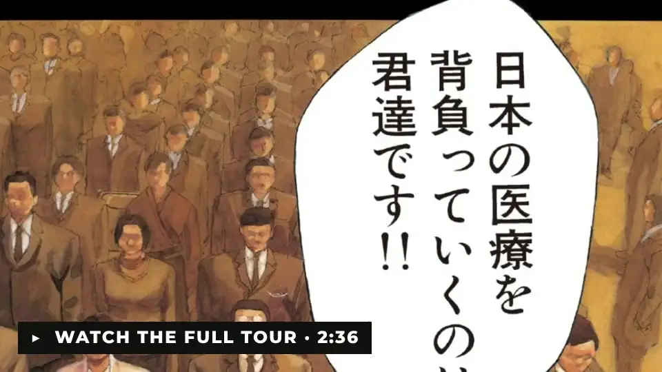</a>
  <br>
  <sub><a href="https://fumetodev.github.io/tour/">Watch the full tour</a>: 2:36, no sound. Or <a href=".github/demo/showcase.mp4">download the MP4</a> (17 MB).</sub>
</p>

<br>

<p align="center">
  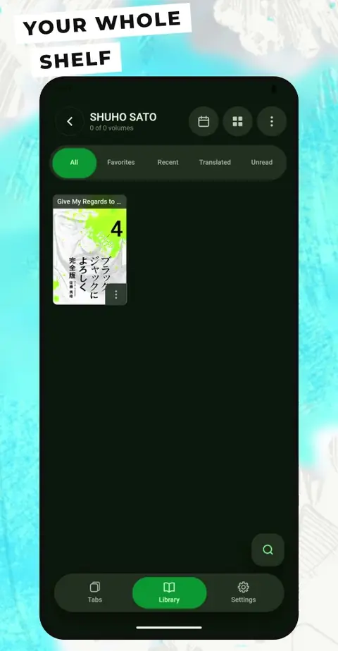
  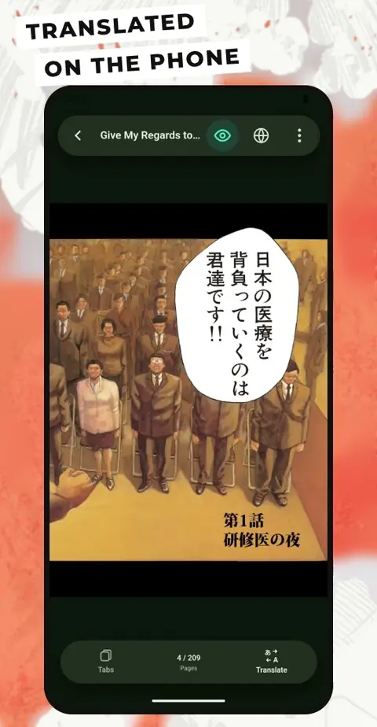
  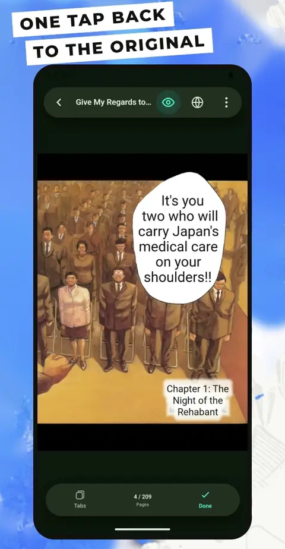
</p>
<p align="center">
  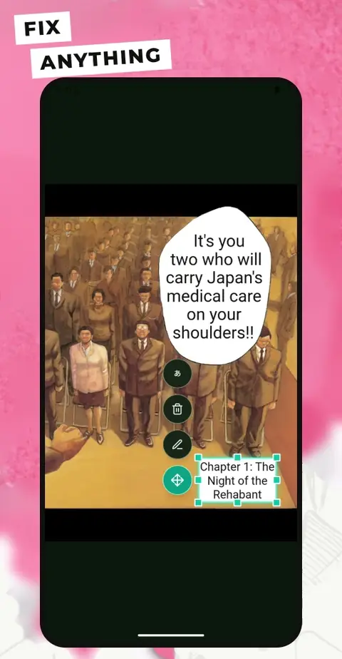
  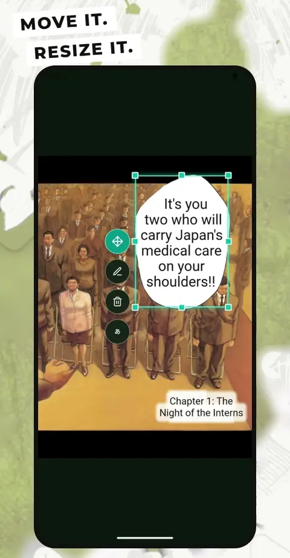
  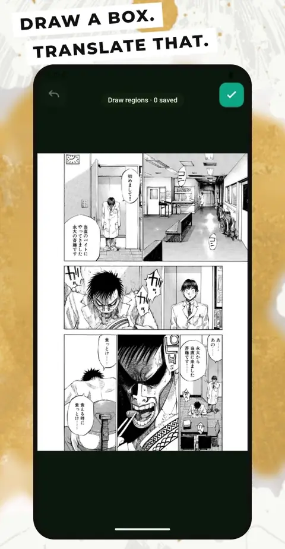
</p>
<p align="center">
  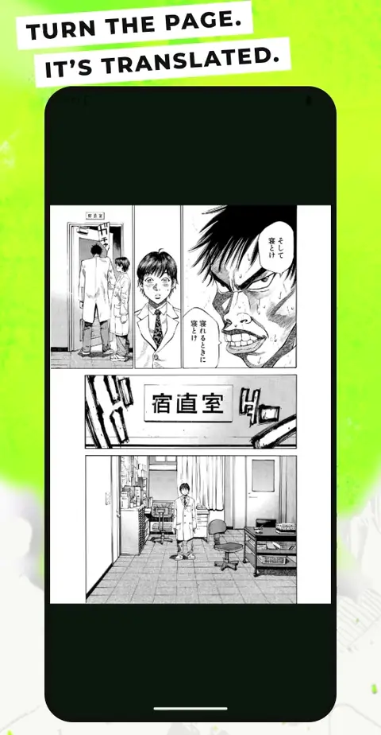
  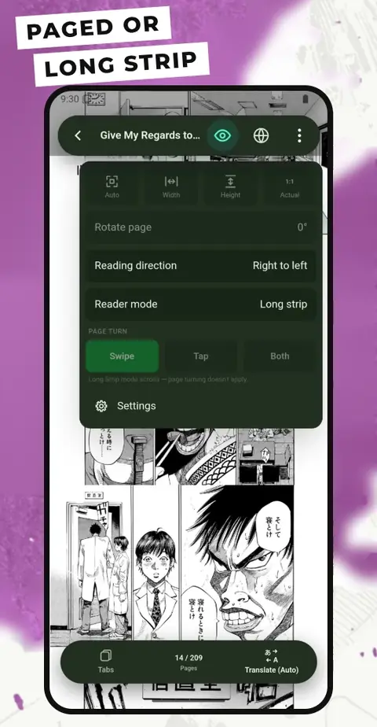
  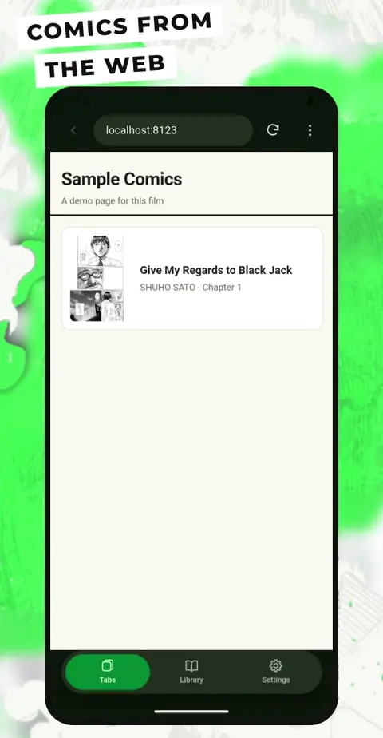
</p>

## Translate

**On your phone, with no key and no network.** It finds the text, reads it, translates it and letters it into the balloons. Models are downloaded once and then work in flight mode:

| Model | Translates | Download |
| --- | --- | --- |
| **FumetoTranslate** (recommended) | Japanese to English. Reads a page's text together, so each balloon is translated with the rest of the page in view | ~448 MB |
| Hy-MT2 1.8B, manga-tuned v5 | Japanese to English | ~1.13 GB |
| Hy-MT2 1.8B, manga-tuned v3 | Japanese to English, and other pairs across 21 target languages | ~1.13 GB |
| Index-Translate 2B, manga-tuned | Japanese to English | ~1.27 GB |
| Your own GGUF | Largely untested; quality and speed are not guaranteed | Your file |

**Or with your own key.** OpenRouter, Claude and any OpenAI-compatible endpoint, or Ollama and LM Studio on your own network. Your key is encrypted on the device and goes only to the provider you chose.

- **Whole volumes in the background.** Batch translation works through a volume page by page, shows its progress in a notification and picks up where it stopped. With a cloud provider, an optional second pass reviews it for consistency.
- **Page by page.** Auto-translate does each page as you reach it.
- **Just the part you want.** Draw a box around any text and translate only that.
- **Keep the result.** Export a translated volume as a CBZ.

## Lettering

Translations go inside the balloons they came from, laid out by a deterministic engine:

- Each line of text is as large as its own balloon holds.
- Conjoined balloons are split at their necks, and one line running through two lobes is threaded across them.
- A balloon shared by two speakers is carved up by the room each one has.
- Unenclosed lettering gets a soft, translucent patch, so the art still shows through.
- English gets real hyphenation.

Models slip. Hold any box to see its source text, rewrite it, move it, resize it or change its font size, and your edits stay.

## Read

<p align="center">
  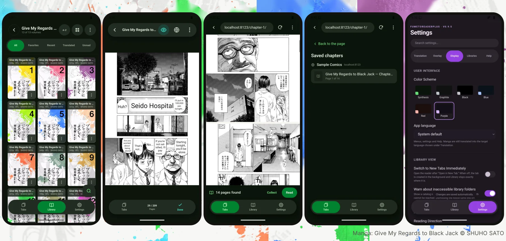
</p>

- **Your files.** CBZ, CBR, ZIP, PDF and EPUB, imported through the file picker, or copied to the device and picked up with Scan.
- **Your server.** Komga, Kavita and YACReaderLibraryServer. Your login stays on the phone and only ever goes to your server.
- **Your way of reading.** Paged or long strip, right to left or left to right, swipe or tap, with tabs, favorites, search and Continue Reading.

## Comics on the web

A built-in browser, opened from Tabs. When a page shows comic pages, a bar offers to read them; Read opens them in the reader, ready to translate like any other comic. On viewers that show one page at a time, Collect gathers them as you flip.

- **It knows no sites.** There is no site list and no per-site code. It works from what's on the page in front of it.
- **Save a chapter** and it opens again through the site, with its translations back. Page images are never kept.
- **It keeps to itself.** Cookies and logins live in the browser's own storage, separate from the app's. Ad blocking uses EasyList and AdGuard's DNS filter, by domain. Pop-ups open only from a tap.

## Make it yours

Six colour schemes and menus in eight languages: English, German, Spanish, French, Indonesian, Italian, Brazilian Portuguese and Russian. The language you read the manga in is a separate setting.

## Install with Obtainium

[Obtainium](https://github.com/ImranR98/Obtainium) can track this repository and keep the app
updated: add `https://github.com/fumetodev/FumetoReaderPlus` as an app and set its APK filter to
`arm64\.apk$`.

FumetoReaderPlus is not on Google Play at the moment. A copy installed from Google Play is signed
with a different key from the GitHub builds, so moving to GitHub means uninstalling it first, which
deletes its local library: export any translated volumes as CBZ before you do.

## Building

Prerequisites: **JDK 21** (exactly — newer JDKs are not supported by this
Gradle), Android SDK + **NDK 29.0.13846066** (`ANDROID_HOME`, `NDK_HOME`
exported), Rust stable, and Node 22/24/26 (`engine-strict` rejects 20/23/25).

```bash
npm ci
npm run dev                              # frontend only, in a browser (WASM fallbacks)
npm run tauri:android-build -- --debug   # debug APK
npm run tauri:android-build              # release (needs a signing keystore + key.properties, both gitignored)
```

The first Android build compiles the vendored llama.cpp for each ABI
(~20 minutes). The rtmdet layout model (~43 MB) is fetched from Hugging Face
during the Gradle build.

## Tests

The test and evaluation suites (unit, UI, device journeys, and the
overlay/OCR evaluation harnesses) are maintained privately, together with the
licensed evaluation corpora they run against. `npm run check` covers the
static gates that ship here.

## Project notes

- SvelteKit 5 SPA running inside a Tauri v2 Android WebView; Kotlin/C++
  accelerators (ONNX Runtime, llama.cpp) behind injected JS bridges; all
  product state lives in the WebView (Dexie/IndexedDB). Desktop builds exist
  but are experimental and unsupported.
- `CLAUDE.md` is the contributor orientation: commands, architecture map, and
  the invariants the test gates enforce.
- This repository is a **cleaned import**: the app was developed privately for
  several months and the history was reset when it was open-sourced.
  Development continues here.

## Licence

GPL-3.0-only (`LICENSE`). Third-party components and models keep their own
licences — see `THIRD-PARTY-NOTICES.md`.

The manga in this README, its video, the Help pages and the fixtures is
*Give My Regards to Black Jack* © SHUHO SATO, used under the publisher's free
secondary-use terms (attribution ships in `static/licenses/`). The clips show the
real app on an Android emulator. Translations are the on-device model's own
output, slips included, apart from the correction the "fix" clip makes on camera.

Questions, bugs, requests: **fumetoreaderdev@gmail.com** or the issue tracker.
